<p align="center">
  
</p>

<h1 align="center">TechDocs Editor for VS Code</h1>

<p align="center">
  Edit <a href="https://backstage.io/docs/features/techdocs/">TechDocs</a> and MkDocs pages like a document,
  without breaking the Markdown your pipeline expects.
</p>

<p align="center">
  <a href="README.pt-BR.md">Português (Brasil)</a>
</p>

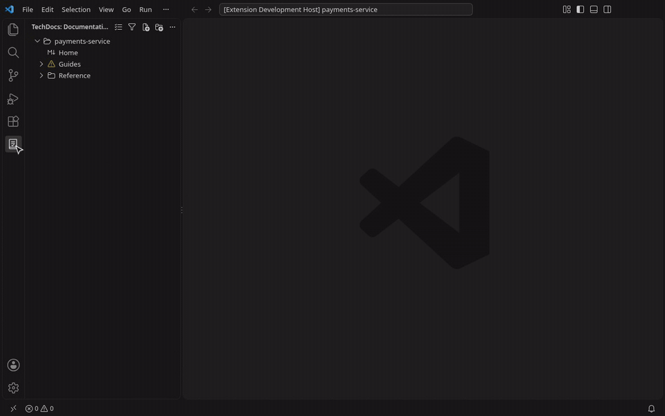

Docs-as-code works well for developers and badly for everyone else: product managers, support, designers and
new hires avoid the docs because of Markdown, admonitions and a lint that fails in the pipeline. TechDocs
Editor gives them a visual editor inside VS Code, and gives the repository back exactly the Markdown it had,
plus their changes.

It is the same editor as the [TechDocs editor plugin for Backstage](https://github.com/edtroleis/backstage-plugin-techdocs-editor),
so pages edited in the portal and in VS Code come out the same.

### Watch it in 2 minutes

[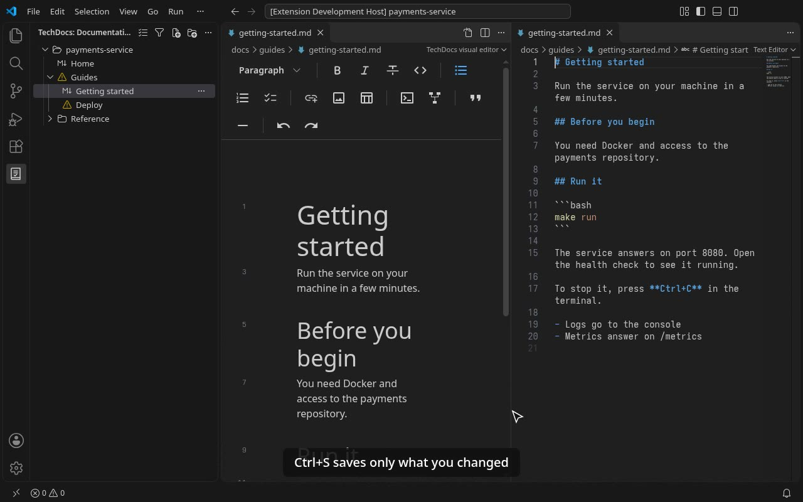](https://github.com/edtroleis/vscode-techdocs-editor/blob/main/docs/media/walkthrough.mp4)

From installing to writing: the documentation tree, a blank page, a page from a template, the visual editor, a
Mermaid diagram and fixing formatting ([video, MP4](https://github.com/edtroleis/vscode-techdocs-editor/blob/main/docs/media/walkthrough.mp4)).

## Features at a glance

| | |
|---|---|
| **Visual editor** | Edit pages like a document; saving changes only what you edited. MkDocs blocks (admonitions, tabs, front matter) are kept |
| **Documentation tree** | The pages in the order of the site menu, ⚠ on pages and sections with problems, rename, move, duplicate and delete with Undo |
| **New pages** | A blank page or a template (runbook, ADR, tutorial…), right in the section of the menu |
| **New sites** | A preview of `mkdocs.yml`, menu and pages before anything is written, from the README or the pages you already have |
| **Formatting** | The pipeline's markdownlint rules, in plain language, with **Fix automatically** |
| **Mermaid** | Diagrams drawn in place, and the site set up to draw them |
| **Images and paste** | Images saved to `docs/assets`; paste from Confluence, Outline and the web as Markdown |
| **Check** | What TechDocs needs to build the site, with the fixes shown before they are applied |
| **GitHub** | Edit docs on GitHub without cloning, with drafts, review and publishing |
| **Keyboard** | Everything reachable without the mouse: Enter in the tree opens the page, with the cursor in the text |

## Features

### A visual editor that keeps your Markdown

- **Opening a page never changes it.** Saving only touches what you edited: the rest of the file stays byte
  for byte (Windows line endings too), so diffs and reviews stay small.
- **MkDocs syntax is kept.** Admonitions (`!!! note`), collapsible blocks (`???`), content tabs (`===`) and the
  front matter at the top of the page (`---`) stay as protected blocks instead of being turned into HTML.
- **Familiar editing:** a toolbar like a word processor, `/` to insert blocks, tables (Tab adds a row), task
  lists, code blocks with syntax highlighting, links to the other pages of the site and images. Images keep their
  alt text.
- **Shortcuts stay in the editor:** Ctrl+B, Ctrl+I, Ctrl+E and the other formatting shortcuts format the text
  instead of running VS Code commands with the same keys.
- **It is still a text file.** Open the Markdown side by side and edit either one: both follow each other,
  with a single undo history (Ctrl+Z works the same in both). A change from outside (a `git pull`) shows up in
  the open page.
- **Your theme:** light, dark and high contrast, with VS Code's colors and fonts.

### Formatting problems in plain language

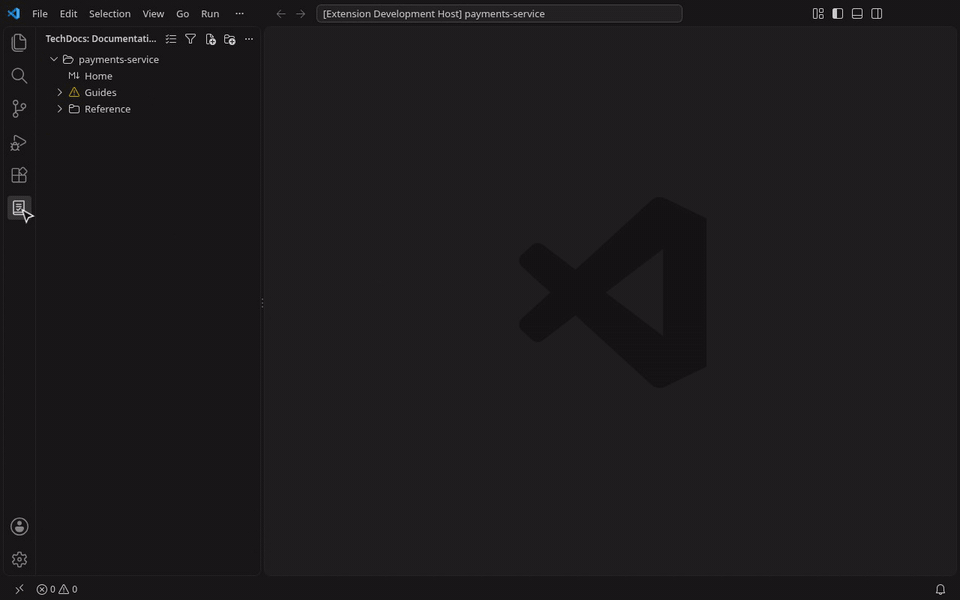

- The same [markdownlint](https://github.com/DavidAnson/markdownlint) rules your pipeline runs, with your
  repository's `.markdownlint.{jsonc,json,yaml,yml}`, checked while you type.
- **⚠ in the tree** on every page with problems, also the ones nobody opened, and on the section around them, so
  you see where the problems are before the pipeline does.
- Problems in the **Problems** panel and in the visual editor, explained in plain language ("There is more
  than one Heading 1 on the page") instead of rule codes.
- **Fix automatically:** a button in the visual editor, a quick fix (light bulb) in the text, and
  `source.fixAll.techdocs` for fix-on-save.
- **Show line:** the line number next to each block opens the Markdown text right there.

### Images go where MkDocs expects them

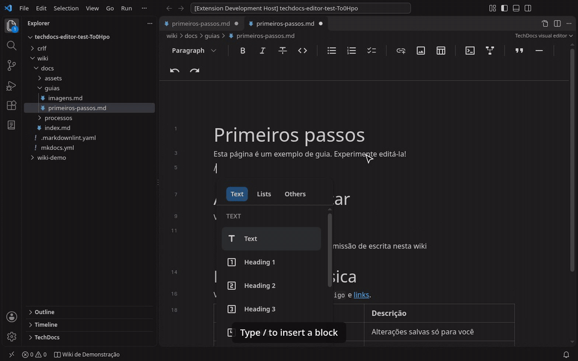

Choose an image from your computer and it is saved to `docs/assets/<timestamp>-<name>`, linked relative to
the page. Never a temporary `blob:` address, and never larger than you allow
(`techdocsEditor.images.maxSizeMB`).

### Paste from Confluence, Outline and the web

Copy a page from Confluence, Outline or a web site and paste it into the visual editor: it comes in as Markdown
that MkDocs builds as is.

- **Code blocks** stay whole, with their lines and language (not inline code on one line).
- **Images** are downloaded and saved to `docs/assets`, like an image from the computer. When an image cannot be
  reached (it asks for a login, or the address expired), you get a warning and the address stays.
- **Info, note, warning and tip panels** become MkDocs admonitions (`!!! info`, `!!! warning`…), with the panel title.
- **Tables** with merged cells come in whole; wide tables are saved compact (`| a | b |`), accepted by the lint.
- **Cleaned up:** the table of contents of Confluence goes away (MkDocs makes its own), bold headings lose the bold,
  pasted headings go down a level when the page already has a Heading 1, and links keep `&` and `@` without a `\`.
- **In the Markdown text** too: paste and pick **Paste as Markdown (TechDocs)** in the paste options to get the same
  Markdown instead of plain text.
- Extra spaces left by the paste are fixed by **Fix automatically**, like any formatting problem.

### Mermaid diagrams

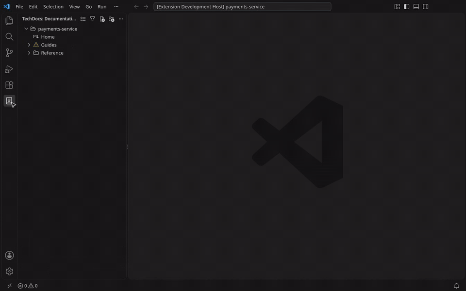

Write flowcharts, sequence diagrams and the other [Mermaid](https://mermaid.js.org) diagrams in a `mermaid` code
block: the visual editor draws them in place, in the colors of your VS Code theme, with no network (also in
VS Code for the Web).

- **Insert** a diagram from the `/` menu or the toolbar (**Diagram (Mermaid)**): it comes with a short flowchart to
  start from. **Edit** on the block shows the code, with the diagram redrawn below as you type.
- **Syntax errors** show in place of the diagram, with the line, and in the Problems panel while the page is open
  in the visual editor.
- **The site draws them too:** the first diagram adds the Mermaid block of `pymdownx.superfences` to `mkdocs.yml`
  (with **Undo**), and the **Check** button points out sites with diagrams and no setup. In Backstage, TechDocs also
  needs the Mermaid addon, installed by the Backstage admins.
- Diagrams that ask for the ELK layout (`layout: elk`) are drawn with the default layout, as on the site.

### Find your way around

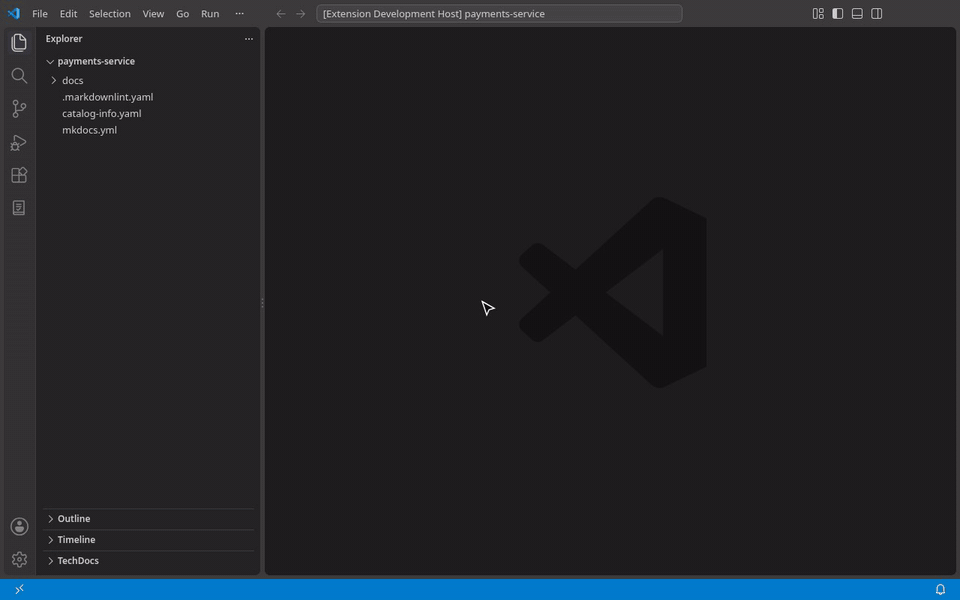

- **TechDocs in the activity bar:** an icon of its own, shown only in workspaces with a `mkdocs.yml`, so the
  rest of your Markdown stays out of the way. It has three sections: **Documentation**, **Check** and the
  optional **Publishing** panel. In a repository with no `mkdocs.yml` yet but with a `README.md`, a `docs/`
  folder with pages or a `catalog-info.yaml`, the icon opens a welcome screen that says what was found, with
  **Prepare the documentation**.
- **Documentation tree:** the pages in the order of the `nav` in `mkdocs.yml` (or of the folders, without a
  `nav`), with the page titles, also as a **TechDocs** section in the VS Code Explorer, under the files. Pages
  missing from the `nav` are grouped under **Not in the menu**, each with a **+** to add it, and `nav` entries
  pointing to missing pages are flagged. **Filter** finds a page by its title.
- **⚠ where something is wrong:** on pages with formatting problems (open or not) and on `nav` entries pointing to
  missing pages. A section with any of them shows ⚠ too, even collapsed, and its tooltip says what: the missing
  page first, since it breaks `mkdocs build --strict`.
- **Keyboard only:** arrows move in the tree and Enter opens the page in the visual editor, with the cursor in the
  text, ready to type.
- **Files in the VS Code Explorer:** moving, renaming or deleting pages and folders of `docs` in the Explorer also
  updates the menu (`nav`) and the links of the pages, with **Undo** in the notice. Right-click a folder ›
  **Open in TechDocs** to show its documentation; right-click a `.md` outside `docs` (the README) › **Copy to a
  Page** to turn it into a page, with images copied into `docs` and links to code pointing to GitHub.
- **Organize from the tree:** the **⋯** on a page or section opens a menu with *Rename* (`F2`), *Duplicate*,
  *Move to…*, *Move up/down* (`Alt+↑`/`Alt+↓`), *Delete* and *New section*; pages and sections can also be
  dragged. Deleting a page says which pages link to it. Every change shows **Undo** (also `Ctrl+Z` in the tree).
- **Only on docs pages:** the **Open in visual editor** button and command show up for pages inside a
  `docs_dir`, not for every Markdown file (READMEs, changelogs).
- **Search** with Ctrl+F in the visual editor, with "1 of 3" and Enter / Shift+Enter between matches.

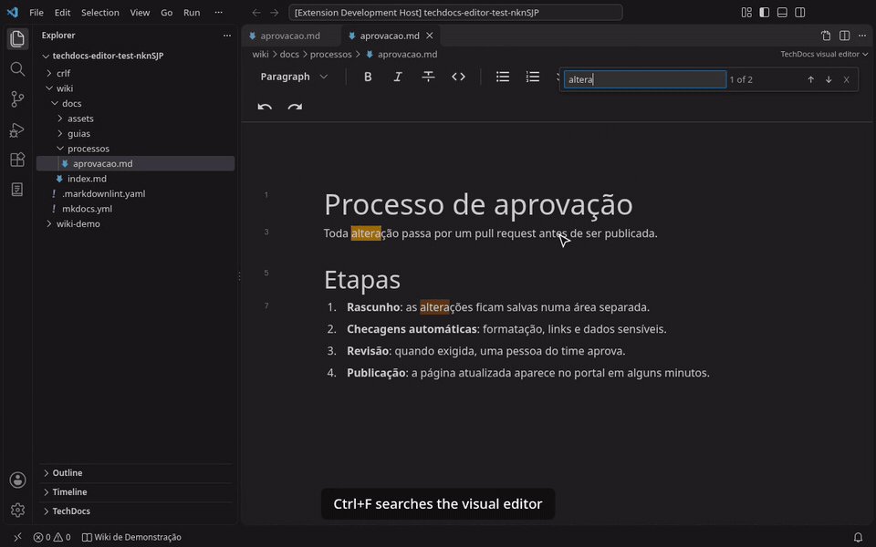

### New pages: blank or from a template

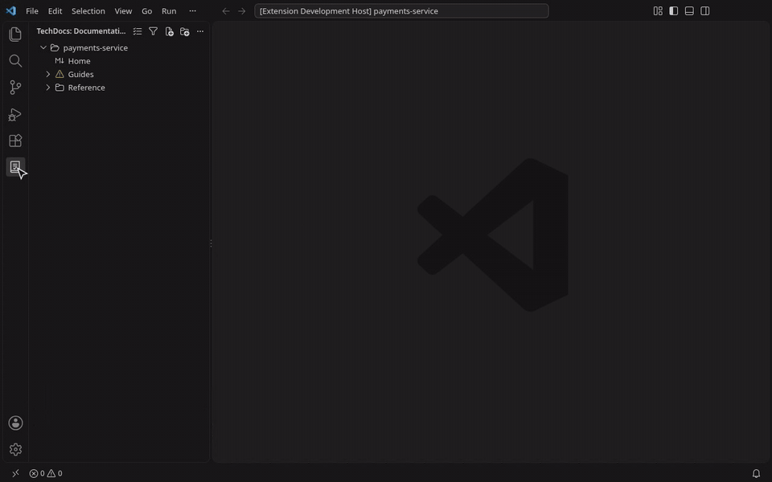

**New Page in This Section** (right-click a section of the Documentation tree) or the **+** of the tree starts with
**Blank page**: only the title, for whoever wants to start from scratch. The file name comes from the title and the
page goes into the menu, in the section you clicked.

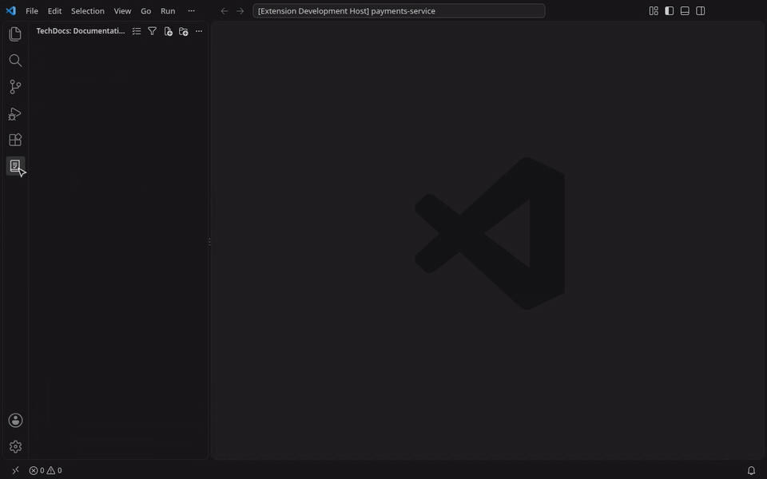

**TechDocs: New page from template…** (command palette, the **+** on a site or section of the
**Documentation** tree, or right-click on a docs folder) creates a page with the sections that kind of page needs, already filled with the title, the date and
the owner from `catalog-info.yaml`, and opens it in the visual editor.

| To… | Templates |
|-----|-----------|
| Learn | Tutorial, Onboarding, Golden path |
| Do a task | How-to guide, Runbook, Troubleshooting |
| Look up | Service home page, Operations and support, API reference, Wiki page |
| Understand | Architecture, Architecture decision record (numbered: `adr/0001-…`), Postmortem |

The file name comes from the title, never overwrites an existing page and never leaves the docs folder.
Templates follow the language of VS Code (English or Portuguese), pass the formatting check and open in the
visual editor without a single change. On a site with a `nav`, the page can go straight into it, in the section
you clicked in the tree; only that line is added to `mkdocs.yml`.

#### How templates evolve

| Layer | Where | How it changes |
|-------|-------|----------------|
| Built-in | This extension | A new version of the extension, updated automatically by the Marketplace |
| Your company or team | `.techdocs/templates/` in the docs repository (or in the site folder, which wins) | A pull request in that repository: nothing to publish |
| Company-wide | One GitHub repository of templates for every docs repository (`techdocsEditor.templates.repository`) | A pull request in that repository: everyone gets it within an hour |

A template is a Markdown page with a `template:` block in the front matter. Repository templates come first
in the list and replace a built-in one with the same file name (`runbook.md`). More folders go in
`techdocsEditor.templates.paths`, and `techdocsEditor.templates.builtIn: false` offers only yours. Pages
already created never change when a template changes.

Company templates live in a folder of a GitHub repository, in the same format, and come between the
repository's and the built-in ones. Set `techdocsEditor.templates.repository` to `owner/repo`, optionally with
the folder and a branch or tag (`acme/docs-templates/templates@v3`; pin a tag to choose when to update), and the
host for GitHub Enterprise (`ghe.acme.com/acme/docs-templates`). The extension tries without signing in first
(public repository) and asks for the GitHub sign-in only if needed. It checks at most once an hour, keeps a copy
for offline use, and **TechDocs: Refresh company templates** checks right away.

```markdown
---
template:
  version: 1
  name: Runbook
  description: Respond to an alert
  category: guide        # tutorial | guide | reference | explanation
  folder: runbooks
  fields:
    alert:
      prompt: Alert name
---

# {{title}}

Alert: {{alert}}. Owner: {{owner}}. Reviewed on {{date}}.
```

#### A whole documentation site

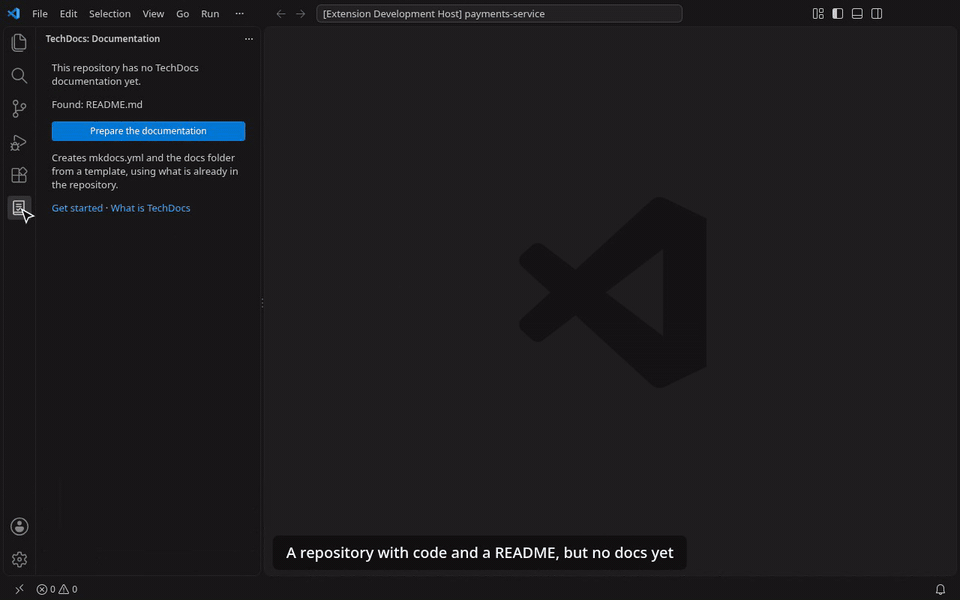

**TechDocs: New documentation site…** (command palette, the Documentation view menu, or right-click on a folder)
and **Create the documentation** in the sidebar open a **preview** in the TechDocs sidebar before anything is
written:

- **On top:** the template, the site name (suggested from the README title) and the owner (from
  `catalog-info.yaml` or `CODEOWNERS`), each saying where the suggestion came from. With no owner found,
  `catalog-info.yaml` starts unchecked; the owner is required only while it is checked.
- **Files or Menu:** uncheck what you do not want; in **Menu**, drag (or use the arrows or Alt+↑/↓) to reorder
  and double-click (or F2) to rename. **+ Page** asks for a path in Files and a title in Menu, with the kind of
  page (tutorial, how-to guide, ADR…); **+ Section** adds a group to the menu.
- **What already exists:** a page in `docs/` that the template also brings asks **Keep current** or **Use the
  template one**; the README can be copied, moved or left out.
- Click a file to see its text. **Create** writes `mkdocs.yml` (with the `nav` and the `techdocs-core`
  plugin), the pages, `catalog-info.yaml` with the TechDocs annotation and, when the repository has none,
  `.markdownlint.yaml` with the Markdown rules, so they go in the commit; it never overwrites a file.
- **The README as the home page:** next to a `README.md`, choose **Copy to docs/index.md**, **Move to
  docs/index.md** (the README keeps a link to the docs) or leave it out. Links to `docs/…` are made relative to
  the docs folder.
- **Pages you already have:** with pages in `docs/` and no `mkdocs.yml`, **Use the pages that already exist**
  creates only `mkdocs.yml`, with the `nav` built from the folders and page titles and the `techdocs-core`
  plugin, shown in a diff first. No page changes.
- **`catalog-info.yaml` only where Backstage is used:** when another repository nearby has one, the panel offers it
  checked; otherwise it starts unchecked and says what that means (the site does not show up in Backstage).

| Site | Pages |
|------|-------|
| Blank (the default) | Only the home page, to start from scratch |
| Service docs | Service home page, Architecture, Operations and support, and the first ADR |
| Team wiki | Home (how to use the wiki), Onboarding, Guides, an example wiki page |
| Golden path | Overview, Getting started tutorial, Troubleshooting |

Your own site templates are folders in `.techdocs/templates/` with a `template.yml`: each file comes from a
page template (`page`, yours or a built-in one) or from a file in the folder (`source`).

```yaml
version: 1
name: Platform service
description: Docs of a service on our platform
fields:
  squad:
    prompt: Squad
files:
  - path: index.md
    title: "{{site_name}}"
    source: home.md          # .techdocs/templates/platform-service/home.md
  - path: runbooks/deploy-failed.md
    title: Deploy failed
    section: Runbooks        # a group in the nav
    page: runbook            # a page template
```

### Check and prepare the repository

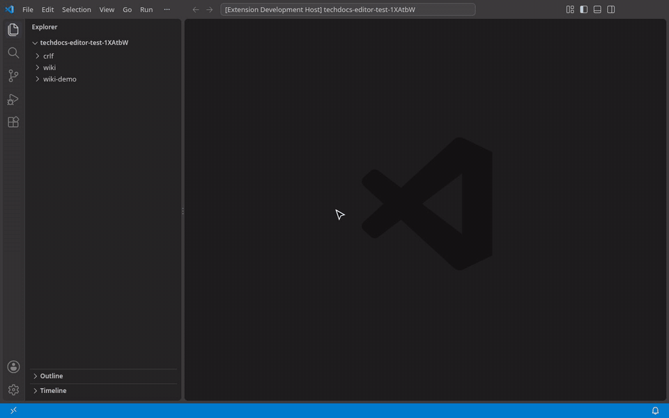

The **Maintenance** section of the TechDocs sidebar (turn on `techdocsEditor.maintainer` to see it) lists, grouped by kind, what is missing or wrong for TechDocs to
build each site: `site_name` and the `techdocs-core` plugin in `mkdocs.yml`, the docs folder
and its `index.md`, `nav` entries pointing to missing pages and pages left out of the `nav`, the
`backstage.io/techdocs-ref` annotation in `catalog-info.yaml`, the markdownlint configuration, formatting
problems, links to missing files and missing images. It checks on its own when it first shows up and again
after you save; the icon shows how many items are left. A click opens the file at the line, and **Fix** shows the
diff of that one fix before writing anything. The same items are in the Problems panel.

The **Check the Documentation** button (✓) in the title of the Documentation tree, also in the TechDocs section of
the Explorer, checks the site shown and says how many items it fixes on its own and how many need you. **View**
opens them in the Problems panel; **Fix all automatically** applies the automatic fixes at once (formatting of
every page, pages left out of the menu, the plugin, missing pages of the menu), and the notice at the end has
**Undo**. After you save, it checks again only the sites already checked.

**TechDocs: Prepare the documentation in this repository** creates a site from a template when there is no
`mkdocs.yml`. Otherwise it goes through the fixes one by one, showing the diff first, so you apply, skip or
stop. Broken links and missing images have no fix: only a person knows the right target.

Not every Backstage reads `catalog-info.yaml` from the repository. The gear of the **Check** section (**Check
options**) sets how the check treats it: **Check only if it exists** (the default; a missing file is just a hint,
not counted on the icon), **Require it** (a missing file is a problem, with a fix that creates a minimal one) or
**Do not use it**. In the default mode, a missing file is mentioned only when another repository nearby has a
`catalog-info.yaml` (a sign that Backstage reads them). Save it **For the team** in `.techdocs-editor.yaml` (`catalog:`) or **Just for me** in the
`techdocsEditor.catalog` setting; the repository file wins.

### Edit documentation on GitHub without cloning

**TechDocs: Open documentation from GitHub…** takes a URL or `owner/repo` (GitHub Enterprise Server too, with
`techdocsEditor.github.host`) and opens the site in the Documentation tree and its home page in the visual
editor, read through the GitHub API. Public repositories open without signing in; links like
`vscode://edtroleis.techdocs-editor/open?host=github.com&repo=acme/wiki&path=docs/index.md` are checked before
anything opens.

- **Ctrl+S saves your draft:** a commit on your own branch for the page (`docs/<login>/<page>`), created on the
  first save from the version you opened, with `[skip ci]` where there is a pipeline. Someone publishing
  before you is never overwritten. Images you add go to `<docs>/assets/` on that branch and show in the editor.
- **The status strip** at the top of the page says where it stands (published, draft, in review, something to
  fix) and offers the next step. **Send for review** fixes the formatting, saves, waits for the checks and asks
  for the review in one step; a failing check stops it and points to the line. In the text editor, the same
  shows in the status bar.
- **My changes** in the sidebar lists the pages you are changing in every repository the extension knows, as
  *Draft* or *In review* (only when you are signed in to GitHub).
- **Publishing details** (collapsed under the pages) has the same buttons as in local mode: **Save and
  check** runs the pipeline and opens a draft pull request, **Send** marks it ready, **Discard** deletes the
  draft. When the merge is done on GitHub, the panel says the page is published.
- **Page History…** (the clock in the editor title) lists the published versions of the page. **Restore** puts
  the text of a version in the editor without saving; save it and it goes through your draft and pull request
  like any other change.
- **New page from template…** works on GitHub sites too: the page (and the `nav` entry, if you choose) is
  committed to the draft branch of the new page, with the repository's own templates read from GitHub.
- **Other pull requests on the page:** the Publishing panel shows open pull requests by other people that change
  the same page (with the author), and yours opened outside the editor.
- **Conflicts:** if your draft changed in another window, saving merges the two versions when they changed
  different passages. When they changed the same passage, a screen shows both side by side and you choose,
  passage by passage, which stays (or both). What was published after your draft started comes into it by
  itself; if it changed the same passage, the panel holds the pull request until you **Resolve conflict**.
- Without signing in, or without write access, pages are read-only; **Sign in to GitHub** in the panel reopens
  the page from your draft, ready to edit.

### Publish without leaving VS Code (optional)

For people who would rather not deal with branches and pull requests: turn on
`techdocsEditor.local.publishPanel` and a **Publishing** panel shows up in the TechDocs sidebar, with the same flow as
the Backstage plugin.

| Button | What happens on GitHub |
|--------|------------------------|
| **Save draft** | Commit and push to the draft branch, with `[skip ci]`: no checks, no pull request |
| **Save and check** | Fixes what the formatting check can fix, commits, pushes and opens a **draft** pull request the first time, which starts the checks |
| **Send for publication** / **Send for review** | Marks the pull request as ready. The page is published by whoever merges it on GitHub: the panel never merges |
| **Discard** | Closes the pull request and, on a branch the panel created, deletes it here and on GitHub |

- On the default branch, saving creates `docs/<your-login>/<page>` and switches to it. On a branch of your
  own, the panel uses that branch.
- Commits only take the page and the new images in `assets/` it uses, never other changes in your workspace.
- The checks of any CI (GitHub Actions check runs and commit statuses), with failures in plain language and a
  link to the line. Without a pipeline, the formatting check of the editor is the verification.
- Repository admins get **Set up checks**: a workflow with the standard checks, the formatting rules and branch
  protection, the files in a pull request for the team to review.
- Signs in with the GitHub account of VS Code (GitHub Enterprise Server too). The token stays with VS Code.

## Getting started

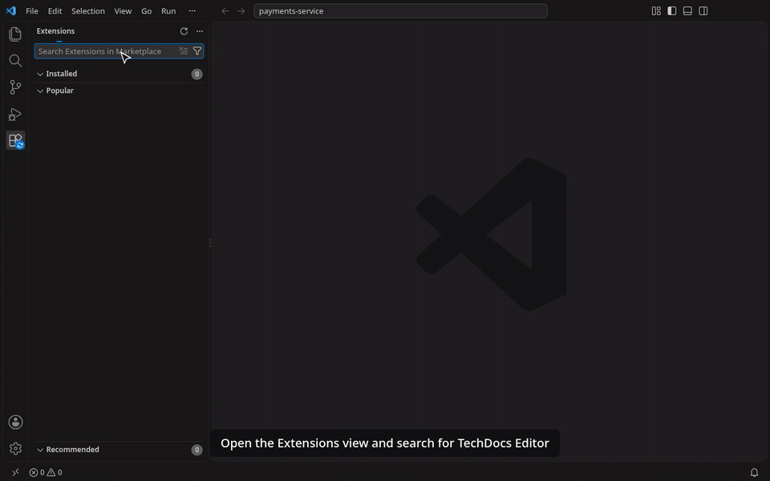

1. Install **TechDocs Editor** from the VS Code Marketplace: in the Extensions view (Ctrl+Shift+X), search for
   *TechDocs Editor* and click **Install**.
2. Open a folder that has a `mkdocs.yml` (the extension starts on its own there). No `mkdocs.yml` yet? The
   TechDocs icon also shows up next to a `README.md`, a `docs/` folder or a `catalog-info.yaml`, with
   **Prepare the documentation**.
3. Open a page:
   - from the **Documentation** section of the TechDocs icon in the activity bar, or
   - with the **Open in visual editor** button in the editor title bar of a `.md` file, or
   - with **Reopen Editor With… → TechDocs visual editor**.

New to it? **Help → Welcome → Get started with TechDocs Editor** walks through creating a site, the sidebar, a
new page, the visual editor, the check, publishing and company templates.

To always open documentation pages in the visual editor, turn on `techdocsEditor.openVisualByDefault`. Use
**Reopen Editor With…** or **TechDocs: Open as Markdown text** to see the text.

## Settings

| Setting | Default | What it does |
|---------|---------|--------------|
| `techdocsEditor.openVisualByDefault` | `false` | Open pages inside a MkDocs `docs_dir` in the visual editor instead of the text |
| `techdocsEditor.siteDepth` | `2` | How many folders below the workspace folder the search for sites (`mkdocs.yml`) goes. Deeper sites appear when you open one of their pages or enter their folder with **Switch Directory or Repo…** |
| `techdocsEditor.syncExplorer` | `true` | Moving, renaming or deleting pages and directories of the docs in the VS Code Explorer also updates the menu of the site (`nav`) and the links of the pages; **Ctrl+Z** in the Explorer undoes it all together. Right-click a directory in the Explorer › **Open in TechDocs** to show it in the TechDocs view |
| `techdocsEditor.sites` | all | Documentation sites offered by **Switch Directory or Repo…** and checked: folders of a `mkdocs.yml` (or a folder above them). Set it with **Filter Sites in the Tree…** in the view's `…` menu |
| `techdocsEditor.maintainer` | `false` | Show the **Maintenance** section (checking the documentation, preparing the repository and its options), for whoever maintains the documentation |
| `techdocsEditor.images.maxSizeMB` | `5` | Largest image the visual editor saves to `assets`. Images go into the repository: large files weigh on every clone |
| `techdocsEditor.templates.paths` | `[]` | More folders with page and site templates, relative to the workspace folder (`.techdocs/templates/` is always read) |
| `techdocsEditor.templates.repository` | `""` | Company templates in a GitHub repository: `owner/repo[/folder][@ref]` |
| `techdocsEditor.templates.builtIn` | `true` | Offer the templates that come with the extension |
| `techdocsEditor.catalog` | `auto` | How the check treats `catalog-info.yaml`: `auto` (check it only if it exists), `required` or `off`. Also the gear in the Maintenance view; `catalog:` in `.techdocs-editor.yaml` wins |
| `techdocsEditor.local.publishPanel` | `false` | Show the **Publishing** panel |
| `techdocsEditor.branchPattern` | `docs/{login}/{path}` | Branch created for a draft when you are on the default branch |
| `techdocsEditor.drafts.skipCi` | `true` | **Save draft** adds `[skip ci]`, so the pipeline only runs on **Save and check** |
| `techdocsEditor.verification.mode` | `auto` | `auto` (the pipeline when there is one), `pipeline` or `editor` |
| `techdocsEditor.verification.startTimeoutSeconds` | `120` | Wait for the first check before warning that nothing started |
| `techdocsEditor.verification.checkHelp` | `{}` | Plain-language message per check name, shown when it fails |
| `techdocsEditor.polling.intervalSeconds` / `idleIntervalSeconds` | `8` / `60` | Check queries while something runs / when idle. Nothing is queried while the window is in the background |
| `techdocsEditor.mode` | `auto` | Where documentation from a GitHub repository opens: `auto` (you choose when it is also in the workspace), `local` or `remote` |
| `techdocsEditor.github.host` | `""` | Your GitHub Enterprise Server, e.g. `github.example.com`, besides `github.com` |
| `techdocsEditor.github.scopes` | `["repo"]` | Scopes asked when signing in to GitHub (`public_repo` for public repositories) |

A `.techdocs-editor.yaml` at the repository root (`verification.mode`, `startTimeoutSeconds`, `checkHelp`)
wins over the settings, so the whole team gets the same checks.

Fix formatting on save:

```jsonc
"[markdown]": {
  "editor.codeActionsOnSave": { "source.fixAll.techdocs": "explicit" }
}
```

## Commands

| Command | What it does |
|---------|--------------|
| **TechDocs: Open in visual editor** | Opens the current `.md` file in the visual editor |
| **TechDocs: Open as Markdown text** | Opens the text of the page side by side with the visual editor |
| **TechDocs: New page from template…** | Creates a documentation page from a template and opens it in the visual editor |
| **TechDocs: New documentation site…** | Creates `mkdocs.yml` and the pages of a documentation site from a template |
| **TechDocs: Check the documentation of the repository** | Lists what is missing or wrong for TechDocs in the Maintenance view and the Problems panel |
| **TechDocs: Prepare the documentation in this repository** | Creates a site, or applies the fixes of the check one by one with the diff first |
| **TechDocs: Open documentation from GitHub…** | Opens a site from a GitHub repository without cloning it (URL or `owner/repo`) |
| **TechDocs: Refresh company templates** | Checks the company templates repository right away instead of waiting for the hourly check |

## How the lint finds its configuration

For each page, the extension looks for `.markdownlint.jsonc`, `.json`, `.yaml` or `.yml` from the folder of
the page's `mkdocs.yml` up to the workspace folder, and uses the first one it finds (markdownlint's defaults
otherwise). Only pages inside a `docs_dir` are checked.

- **Restricted mode:** in an untrusted workspace, the repository's configuration is not read and pages are
  not checked until you trust the folder.
- **With the [markdownlint extension](https://marketplace.visualstudio.com/items?itemName=DavidAnson.vscode-markdownlint)
  installed,** its diagnostics win in the Problems panel, so you don't see each problem twice. The visual
  editor still shows the list.

## Privacy and security

- **No telemetry.** The extension collects nothing.
- **No network in local mode** unless you turn on the publishing panel. Pages are read and written through
  VS Code; the only requests are for images your pages already link with `https://`. The panel talks only to
  the GitHub of your repository's remote, from the extension host: the token never reaches the webview. With
  `techdocsEditor.templates.repository` set, the extension also reads that repository, at most once an hour;
  in an untrusted workspace only your user setting counts, never the folder's.
- **Remote mode** talks only to the GitHub host of the repository you opened. The list of open sites keeps only
  the host, `owner/repo` and the folder of `mkdocs.yml`, never a token.
- The visual editor runs in a webview with a strict content security policy: only the extension's own
  scripts run.

## Requirements and limitations

- VS Code 1.100 or later.
- Works on local folders and clones (local mode). Git stays with VS Code's source control.
- In local mode, the publishing panel needs a clone with a GitHub remote and VS Code's Git extension.
- Remote mode, not yet: VS Code for the Web. See the [roadmap](specs/00-visao-geral.md#fases).
- Math (LaTeX) is off, as in TechDocs' default MkDocs setup.
- Some advanced Material for MkDocs constructs, such as grid cards and HTML blocks with `markdown`, are still
  being hardened. Review the diff before committing pages that use them.

## Contributing

Bug reports and pull requests are welcome. See [CONTRIBUTING.md](CONTRIBUTING.md) for the development setup
and the tests.

## License

[Apache-2.0](LICENSE).
